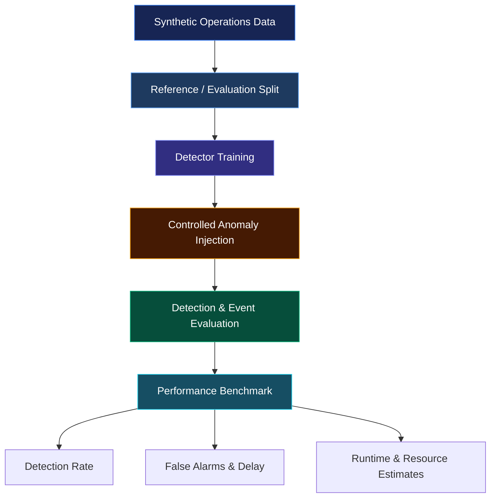

# ASYMPTOTIC

<p align="center">
  <strong>Physics-Informed AI for Sustainable Data Center Infrastructure</strong>
  <br>
  Detección de anomalías en consumo de agua y energía mediante modelos estadísticos, residuales y aprendizaje automático.
</p>

<p align="center">
  
  
  
  
  
</p>

---

## Overview

ASYMPTOTIC investigates whether lightweight statistical detectors can identify small water leaks and operational inefficiencies in simulated AI data centers while reducing computational cost.

The project compares five detection approaches under controlled scenarios, measuring detection rates, false alarms, detection delay, and execution cost.

**The central hypothesis:** deviations from expected system behavior can reveal anomalies that fixed thresholds miss, without requiring the computational overhead of more complex models.

> **Research prototype.** All operational data are synthetic. Results are experimental; energy and carbon estimates rely on explicit assumptions. Alerts require human review and must not be used as real infrastructure diagnoses.

## Detection Pipeline



## Detection Methods

| Detector | Approach | Purpose |
|:--|:--|:--|
| Fixed Rules | PUE/WUE thresholds | Baseline operational rules |
| Isolation Forest | Unsupervised machine learning | General anomaly detection |
| Residual 3σ | Expected behavior + standardized residual | Detect deviations from a fitted model |
| Residual CUSUM | Cumulative residual monitoring | Detect persistent small deviations |
| Z-Score | Statistical standardization | Lightweight anomaly detection |

## Residual-Based Detection

The detector estimates expected water consumption from operational variables such as IT energy, workload, and temperature.

### Residual

Given an observed measurement $y_t$ and the model prediction $\hat{y}_t = f(\mathbf{x}_t)$, where $\mathbf{x}_t$ is the vector of operational variables at time $t$, the residual is:

$$
r_t = y_t - \hat{y}_t
$$

Where:

- $y_t$: observed measurement.
- $\hat{y}_t$: expected measurement predicted by the model.
- $r_t$: residual, representing the deviation from expected behavior.

### Standardization

To evaluate the magnitude of the deviation relative to normal model errors, the residual is standardized:

$$
z_t = \frac{r_t - \mu_r}{\sigma_r}
$$

where $\mu_r$ and $\sigma_r$ are the mean and standard deviation of the residuals on the reference data $\mathcal{D}_{\text{ref}}$ with $N$ samples:

$$
\mu_r = \frac{1}{N}\sum_{i=1}^{N} r_i,
\qquad
\sigma_r = \sqrt{\frac{1}{N-1}\sum_{i=1}^{N}\left(r_i - \mu_r\right)^2}
$$

### Residual 3σ Detector

An observation is flagged as anomalous when the absolute standardized residual exceeds the threshold:

$$
\text{alarm}_t =
\begin{cases}
1 & \text{if } |z_t| > 3 \\
0 & \text{otherwise}
\end{cases}
$$

### CUSUM Detector

The **CUSUM detector** accumulates deviations over time, which helps identify persistent changes that are hard to detect from individual observations:

$$
S_t^{+} = \max\left(0,\; S_{t-1}^{+} + z_t - k\right)
$$

$$
S_t^{-} = \max\left(0,\; S_{t-1}^{-} - z_t - k\right)
$$

with $S_0^{+} = S_0^{-} = 0$, where $k$ is the allowance (slack) parameter. An alarm is raised when:

$$
S_t^{+} > h \quad \text{or} \quad S_t^{-} > h
$$

where $h$ is the decision threshold.

### Data Leakage Prevention

Both methods are fitted using reference data only. Anomaly labels and scenario identifiers are excluded from detector inputs to prevent data leakage.
\]

The **CUSUM detector** complements this approach by accumulating deviations over time, helping identify persistent changes that may be difficult to detect from individual observations.

Both methods are fitted using reference data only. Anomaly labels and scenario identifiers are excluded from detector inputs to prevent data leakage.

A large deviation may indicate an anomaly. CUSUM complements this approach by accumulating evidence across observations.

## Experimental Findings

Synthetic leakage experiments across 10 random seeds produced the following representative results:

| Detector | Normal Regime | Difficult Regime | Approx. Fit + Prediction |
|:--|:--:|:--:|--:|
| Fixed Rules | 0% through 50% leakage | 0% through 30% | 0.25 ms |
| Isolation Forest | 31–49% | 28–53% | 103 ms |
| Residual 3σ | 88% at 5% leakage | 92% at 20% leakage | 5 ms |
| Residual CUSUM | 100% | 100% from 20% leakage | 6.5 ms |
| Z-Score | 100% from 30% leakage | 100% from 50% leakage | 1.3 ms |

*Selected results from a synthetic benchmark. Detection performance depends on anomaly magnitude, noise, and operating conditions.*

### Key Observations

- Fixed thresholds missed small leakage scenarios in the tested configuration.
- Residual 3σ detected 88% of events at 5% leakage in the normal regime.
- Residual CUSUM achieved high sensitivity, with approximately 0.2–0.35 false alarms per day in the reported normal-regime experiment.
- The difficult regime exposes limitations caused by noise and nonlinear behavior.
- Residual 3σ required approximately 20 times less fit-and-prediction time than Isolation Forest in this benchmark.

These results motivate further validation; they do not establish universal superiority.

## Architecture


### Core Modules

| Module | Responsibility |
|:--|:--|
| `greenai/base_data.py` | Synthetic reference data generation |
| `greenai/scenarios.py` | Controlled leakage and inefficiency scenarios |
| `greenai/detectors.py` | Five anomaly detection methods |
| `greenai/events.py` | Event detection and evaluation metrics |
| `greenai/explain.py` | Observed-versus-expected explanations |
| `greenai/bench.py` | Runtime, memory allocation, and uncertainty measurements |
| `greenai/service.py` | Application services and validation |
| `greenai/sweep.py` | Multi-seed experimental sweeps |
| `stack_b_api_web/main.py` | FastAPI application and endpoints |

## API Contracts

| Endpoint | Responsibility |
|:--|:--|
| `/api/detectors` | Detector information |
| `/api/scenario` | Scenario evaluation |
| `/api/explain` | Anomaly explanation |
| `/api/sweep` | Benchmark sweep |

Responses identify simulated results with `simulated: true`. Dates use ISO 8601 formatting, unknown values use `null`, and invalid parameters return HTTP 422 errors.

## Reproducibility

The evaluation separates clean reference data from anomalous evaluation windows. Ground-truth labels and scenario identifiers must not be used as detector inputs.

The benchmark evaluates multiple random seeds and both normal and difficult synthetic regimes.

Metrics include:

- Detection rate.
- False alarms per day.
- Detection delay.
- Undetected excess resource consumption.
- Fit and prediction runtime.
- Peak Python-traced memory allocation.
- Estimated energy and carbon under stated assumptions.

Runtime depends on hardware and software configuration. Energy and carbon figures are estimates, not direct measurements.

## Run Locally

Python 3.13 was used in the development environment. Python 3.12 is recommended by the original participant kit.

```bash
python -m venv .venv
```

Activate the environment and install the dependencies declared by the repository.

Start the API from the project root:

```bash
python -m uvicorn stack_b_api_web.main:app --host 127.0.0.1 --port 8000
```

Open the web interface:

```text
http://127.0.0.1:8000/static/deteccion.html
```

Run the automated tests:

```bash
python -m pytest tests -q
```

Inspect the benchmark options:

```bash
python -m greenai.sweep --help
```

## Project Scope & Limitations

- Synthetic data only; no real data center telemetry has been validated.
- The residual detector uses a linear model and may degrade under nonlinear conditions or distribution shifts.
- The difficult regime is a synthetic robustness test, not proof of real-world generalization.
- Runtime measurements were obtained on a specific development machine.
- Memory measurements from `tracemalloc` do not represent total process RAM.
- Energy and carbon estimates depend on assumed hardware power and emissions factors.
- No water-per-AI-query attribution is claimed.
- Alerts are experimental signals and require human review.

## License

Original project code and documentation are distributed under the MIT License, subject to the repository's license files and third-party dependency licenses.

---

<p align="center">
  <strong>ASYMPTOTIC</strong>
  <br>
  <sub>Mathematics × Physics × AI × Computational Efficiency</sub>
</p>
